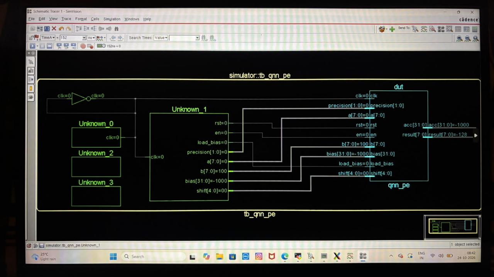
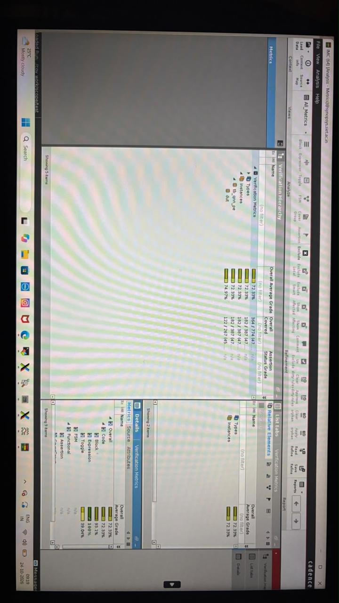
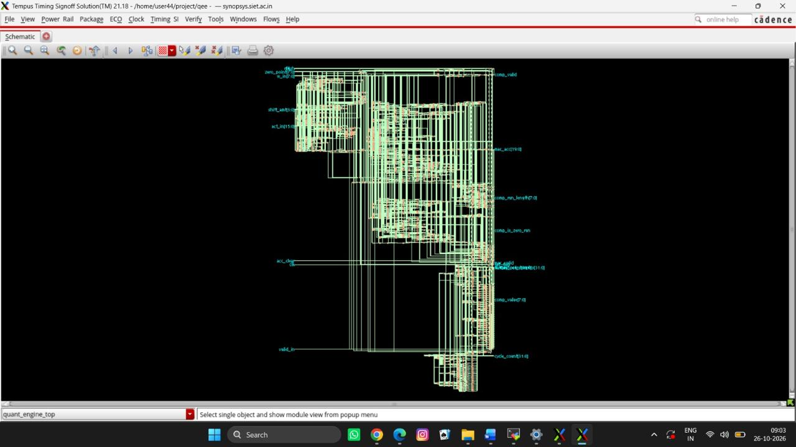
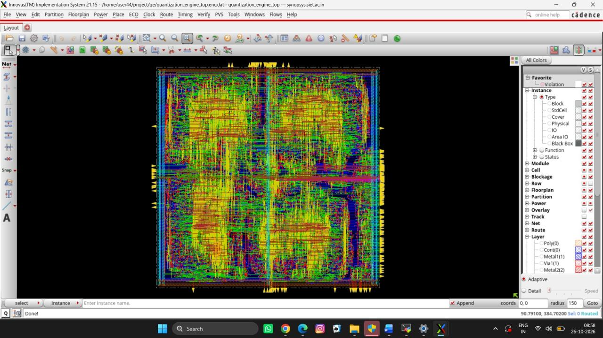
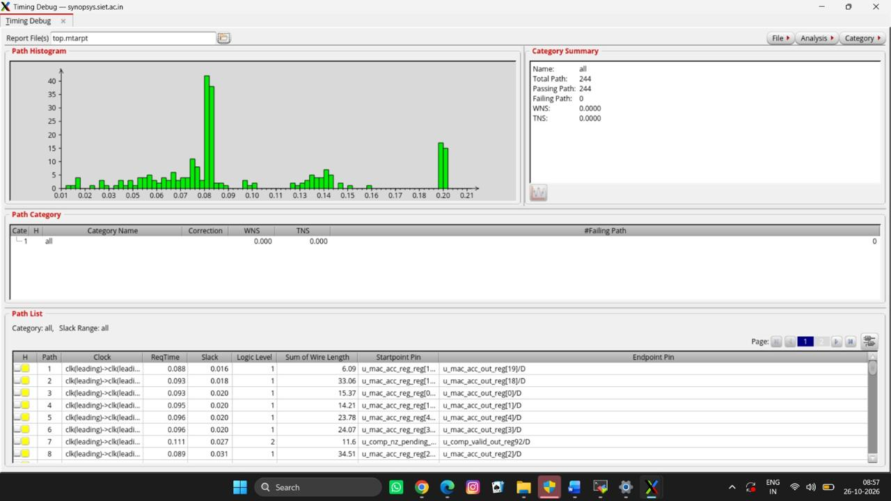
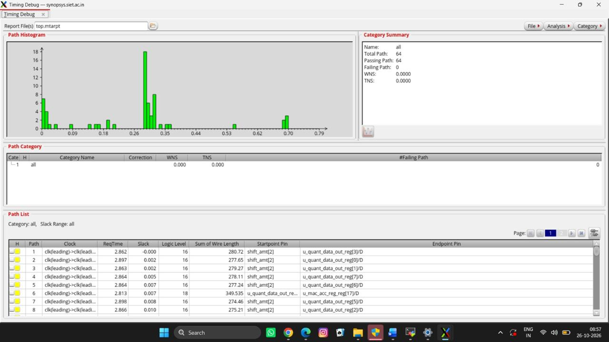

# ⚡ Quantization Engine
### Hardware-Efficient INT8 AI Quantization Engine IP Core

> **VLSI NEXUS** | VconnecTech Engineering Marathon 2026

---

## 📌 Project Overview

The Quantization Engine is a hardware-efficient AI accelerator IP core designed to enable low-power and resource-efficient edge inference by performing quantized arithmetic operations.

The project focuses on implementing efficient fixed-point arithmetic, reduced-precision computation, optimized multiplication, and quantization techniques to minimize hardware complexity while maintaining computational accuracy.

The proposed architecture supports low-precision arithmetic and efficient data processing for resource-constrained hardware platforms.

---

## 🎯 Problem Statement

AI inference on resource-constrained edge devices faces challenges related to:

- High computational complexity
- Memory consumption
- Power requirements
- Hardware resource utilization
- Latency during inference

This project explores hardware-efficient quantization techniques to address these challenges using optimized digital hardware architecture.

---

## 💡 Proposed Solution

The proposed Quantization Engine incorporates:

- INT8 fixed-point arithmetic
- Reduced precision computation
- INT4 and INT2 operating modes
- Efficient multiply-accumulate operations
- Zero-skipping optimization
- Saturation handling
- Requantization and rounding
- Shift-based arithmetic optimization
- Hardware-efficient data processing

---

## ⚙️ Key Features

- 🔢 Multi-precision computation: INT8, INT4 and INT2
- ⚡ Efficient arithmetic operations
- ➗ Optimized multiplication architecture
- 🚀 Zero-skipping optimization
- 🔄 Multiply-Accumulate (MAC) operation
- 🛡️ Overflow protection and saturation logic
- 📉 Requantization and rounding
- 🧠 Designed for efficient edge AI inference

---

## 🏗️ Architecture

The Quantization Engine consists of functional blocks designed to support efficient quantized computation.

### Functional Flow

```text
Input Data
    │
    ▼
Precision Selection
(INT8 / INT4 / INT2)
    │
    ▼
Quantized Arithmetic Unit
    │
    ▼
Zero-Skipping Logic
    │
    ▼
Multiply-Accumulate (MAC)
    │
    ▼
Requantization & Rounding
    │
    ▼
Saturation Logic
    │
    ▼
Output Result
```

---

## 💻 RTL Implementation

The RTL implementation is developed using Verilog HDL.

### RTL Modules

| File | Description |
|---|---|
| `rtl/qnn_pe.v` | Quantized Processing Element implementing precision selection, arithmetic operations, MAC, zero-skipping and saturation logic |

---

## 🧪 Verification

The project includes a Verilog testbench to verify the functionality of the Quantization Engine.

### Testbench

`testbench/tb_qnn_pe.v`

### Verification Scenarios

- INT8 computation
- INT4 computation
- INT2 computation
- Zero-skipping functionality
- Shift-based computation
- Positive saturation
- Negative saturation
- Arithmetic functionality

---

## 📊 Implementation Results

### RTL Simulation



### Verification Results



### RTL Schematic



---

### Innovus Layout



### Timing Analysis



### Optimized Timing Analysis



---

## 🛠️ Tools & Technologies

- Verilog HDL
- RTL Design
- Digital Design
- Cadence Simulink
- Cadence Genus
- Cadence Innovus
- Logic Synthesis
- Physical Design
- Static Timing Analysis (STA)
- Functional Verification

---

## 🔄 Design Flow

```text
Architecture Design
        │
        ▼
RTL Development
        │
        ▼
Testbench Development
        │
        ▼
RTL Simulation & Verification
        │
        ▼
Logic Synthesis
        │
        ▼
Floorplanning
        │
        ▼
Placement & Routing
        │
        ▼
Timing Analysis
        │
        ▼
Physical Design Evaluation
```

---

## 📄 Project Documentation

The complete project documentation is available here:

📁 **[Quantization Engine Project PDF](docs/Quantization_Engine_Project.pdf)**

---

## 👥 Team Members

### VLSI NEXUS

- **Sasmitha S P**
- **Subiksha L**
- **Ashwin S**
- **Varsha V R**

Developed as part of the **VconnecTech Engineering Marathon 2026**.

### VLSI NEXUS

Developed as part of the **VconnecTech Engineering Marathon 2026**.

---

## 🚀 Future Scope

- INT4 and INT2 optimization
- Improved power optimization
- Advanced quantization algorithms
- Per-channel quantization
- Integration with AI accelerator architectures
- AXI-based data interfacing
- Further area and timing optimization
- FPGA implementation and validation

---

## 📂 Repository Structure

```text
quantization-engine/
│
├── README.md
│
├── docs/
│   ├── README.md
│   └── Quantization_Engine_Project.pdf
│
├── rtl/
│   └── qnn_pe.v
│
├── testbench/
│   └── tb_qnn_pe.v
│
└── images/
    ├── README.md
    ├── rtl_simulation.png
    ├── verification_results.png
    ├── rtl_schematic.png
    ├── floorplan.png
    ├── innovus_layout.png
    ├── timing_analysis.png
    └── timing_analysis_optimized.png
```

---

⭐ If you find this project interesting, feel free to explore the RTL implementation and project documentation.
